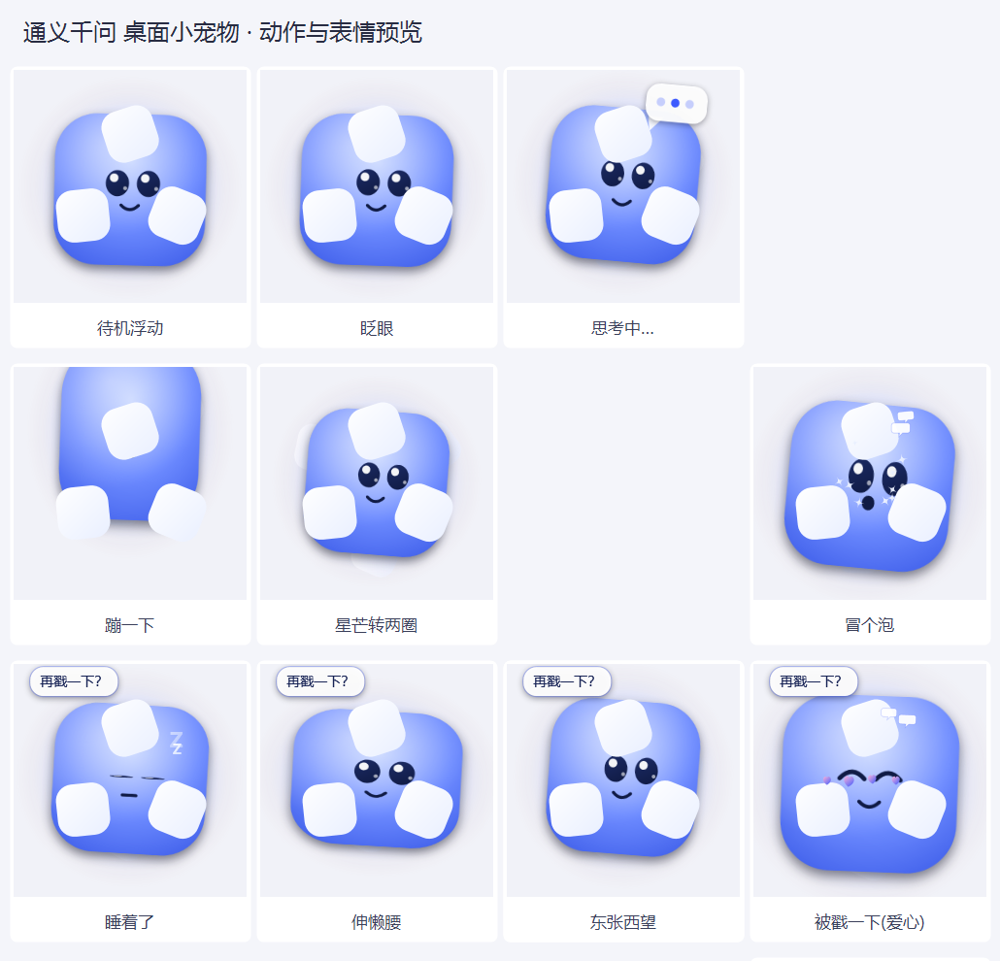
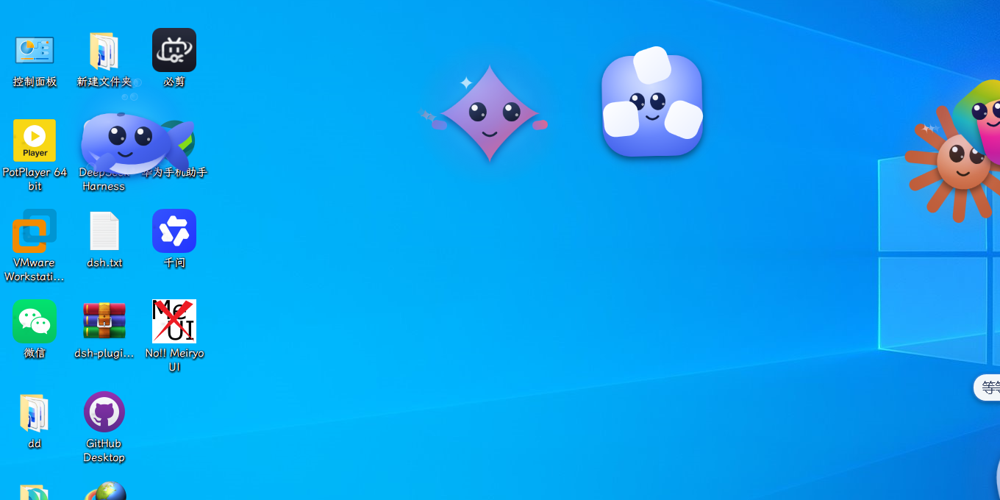

# 通义千问 桌面小宠物 🌀

> 📦 **免安装下载**：[Releases](https://github.com/qi-cluadld/QwenPet/releases/latest) 下载 zip，解压后双击 `启动宠物.vbs` 即可（不用 clone、不用装任何运行库）。


一只趴在你桌面上的 **通义千问** 小宠物：会浮动、眨眼、转圈、思考、睡着，点它有反应，并且和桌面上其它 AI 宠物（Gemini ✨ / DeepSeek 🐋 / ChatGPT ✦ / Claude ☀ / 豆包 🥟 / Qwen 🌀 / Copilot 🚀）**互相打招呼、聊天、送爱心、吵架再和好**。

- **零依赖**：只用 Windows 自带的 WPF + PowerShell，不用装 Python / Node / 任何运行库
- **不抢焦点**：`WS_EX_NOACTIVATE | WS_EX_TOOLWINDOW`，点它不会打断你打字
- 连开发辅助脚本都是 `.ps1`，一个 `.py` 都没有





## 快速开始
1. 双击 **`启动宠物.vbs`**（无控制台窗口），它会出现在屏幕右下角；被安全软件拦了就改用 **`启动宠物.bat`**
2. 左键点一下 = 戳它；按住左键拖动 = 换位置；右键 = 菜单（打招呼 / 摸摸头 / 大小 / 退出）
3. 开机自启：把 `启动宠物.vbs` 的快捷方式丢进 `shell:startup`

## 联动（同一台机器上开着几只就联动几只）
靠命名共享内存 `DesktopPets.Interop.v4`（7 个槽位）交换位置与状态，**不需要后台服务**：

| 行为 | 表现 |
| --- | --- |
| 👋 见面打招呼 | 靠近时互相转头、笑脸、冒爱心（对方睡着还会叫醒） |
| 🗣 真·对话 | 一问一答聊 2~3 个回合，**带话题记忆**（被打断的话题下次接着聊） |
| 💬 说话气泡 | 打招呼 / 聊天 / 一起玩 / 串门 / 被戳 / 发呆时都有台词 |
| 🎉 一起玩 · ❤ 传爱心 · 🏃 追逐 | 动作同步、互送小心心、追着玩 |
| 😤 吵架与和好 | 被追烦了会生气躲开，对方道歉送心才哄好 |
| 📏 排排站 · ↔️ 让位 · 🚶 串门 | 挨着时对齐高度、挤在一起会挪开、离得远会串门 |

台词和话题在 `lines.json`（`{me}` / `{you}` 会替换成名字）；删掉 `social.ps1` 就不联动。

## U 盘热插拔自动备份
双击 **`启动U盘备份.vbs`**（无窗口后台跑），之后每次插入 U 盘都会自动备份到 `<U盘>\桌面小组件\`。

## 文件与开发
```
QwenPet\
├─ QwenPet.ps1        主程序(单文件可独立运行)
├─ social.ps1           七只共用的联动模块(共享内存 + 社交/对话/情绪)
├─ lines.json           台词表与话题表
├─ qwen_pet.ico/.png   图标
├─ 启动宠物.vbs / .bat   启动器
├─ 启动U盘备份.vbs       U 盘自动备份
├─ build\               开发用: 角色代码块 + build.ps1(组装主程序)
├─ tools\               shot.ps1 / make_assets.ps1 / usb_backup.ps1
└─ preview\             12 张动作预览 + 合集图
```
改完外观重新出图：
```powershell
powershell -NoProfile -ExecutionPolicy Bypass -File build\build.ps1
powershell -NoProfile -ExecutionPolicy Bypass -File QwenPet.ps1 -Preview preview -PreviewAlpha
powershell -NoProfile -ExecutionPolicy Bypass -File QwenPet.ps1 -Preview "$env:TEMP\alpha" -PreviewAlpha
powershell -NoProfile -ExecutionPolicy Bypass -File tools\make_assets.ps1 -AlphaDir "$env:TEMP\alpha"
```

## 同系列（十二只）

| 宠物 | 品牌 | 仓库 |
| --- | --- | --- |
| 小星星 ✨ | Gemini | https://github.com/qi-cluadld/GeminiPet |
| 小鲸鱼 🐋 | DeepSeek | https://github.com/qi-cluadld/DeepseekPet |
| 小花 ✦ | ChatGPT | https://github.com/qi-cluadld/ChatGPTPet |
| 小太阳 ☀ | Claude | https://github.com/qi-cluadld/ClaudePet |
| 小豆包 🥟 | 豆包 | https://github.com/qi-cluadld/DoubaoPet |
| 小千 🌀 | 通义千问 | https://github.com/qi-cluadld/QwenPet |
| 小飞 🚀 | Copilot | https://github.com/qi-cluadld/CopilotPet |
| 小象 ⭕ | 智谱 GLM | https://github.com/qi-cluadld/GLMPet |
| 小格 ⚔ | Grok | https://github.com/qi-cluadld/GrokPet |
| **小谷** | 渐变 G（2025） | [GoogleGPet](https://github.com/qi-cluadld/GoogleGPet) |
| **小彩** | 扁平四色 G（2015） | [GoogleFlatPet](https://github.com/qi-cluadld/GoogleFlatPet) |
| 小智 ✨ | Apple Intelligence | https://github.com/qi-cluadld/ApplePet |

十二只可以**同时运行并互相联动**：打招呼、真对话（带话题记忆）、传爱心、追逐、吵架和好，以及**一对一打架**。
一键安装包（含十二只，可自选）：https://github.com/qi-cluadld/DesktopPetsInstaller/releases
## License
MIT